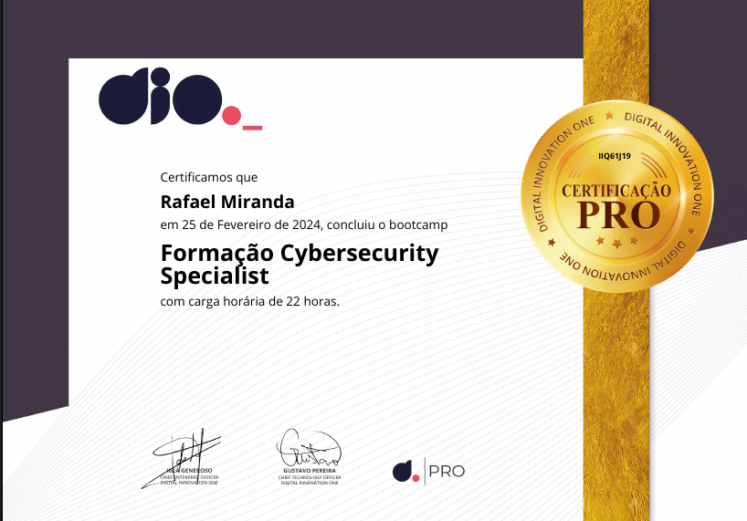

# Olá! Sou Raffiz, apaixonado por tecnologia e desafios éticos.

Focado em Segurança Ofensiva, com foco em Web Application Pentesting e exploração de vulnerabilidades em aplicações web. Também estudo programação de baixo nível, Assembly e engenharia reversa, buscando compreender o funcionamento interno de sistemas e software.

---

🧪 Laboratórios de Segurança

---

### Meu Portfólio

<!-- -->

*Observação: Em reconstrução.*

---
### 📚 Formação

---

